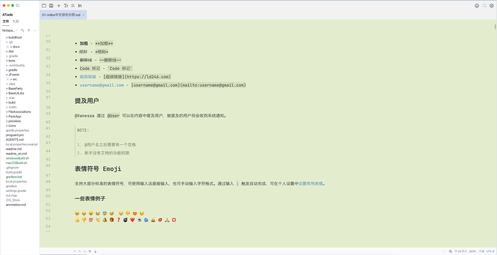
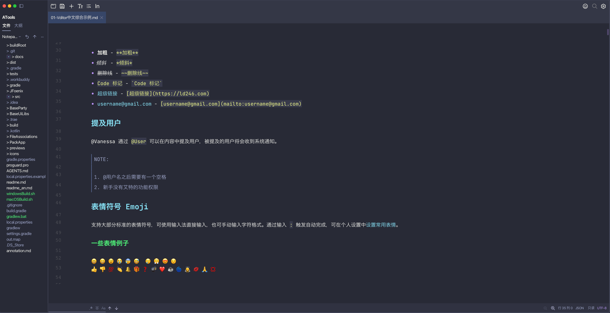

# Notepadmm

[中文](readme.md)

**ATools** (project name: Notepadmm) is a professional log analysis and Markdown editor for Windows and macOS.

## 1. Professional log analysis

- Open **gigabyte-sized log files** with buffered, on-demand chunk loading instead of reading the entire file at startup.
- Use multi-pattern search, regular expressions, color-coded highlighting, and saved search profiles. Click results to locate the source and trace errors, business events, and request flows.

## 2. Markdown support

Document outlines, images, editable tables, syntax highlighting, and offline Mermaid diagrams, with source/preview switching and HTML/PDF export. See the [Markdown documentation](docs/Markdown.md) for features and shortcuts.

light green:

dracula:

## 3. Packaging

Install JDK 25, copy `local.properties.example` to `local.properties`, and configure your local JDK paths. Full macOS packaging also requires a signing certificate. Run from the project root:

| macOS command | Purpose |
| --- | --- |
| `./macOSBuild.sh -s` | Compile, quickly sync to the installed `/Applications/ATools.app`, and restart it. |
| `./macOSBuild.sh -p` | Create a complete DMG, replace `/Applications/ATools.app`, and launch it. |

Use `-p` for the first installation or after upgrading the JDK, JavaFX, or third-party dependencies; use `-s` for everyday development. On Windows, `./windowsBuild.sh -p` creates an EXE installer. See the [build notes](docs/编译注意事项.md) for configuration details.
